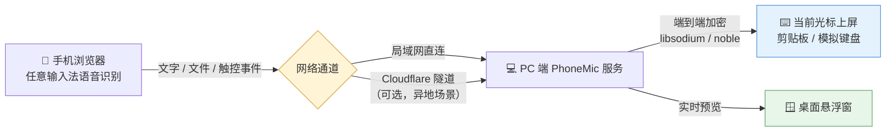

<div align="center">
  
</div>

<h1 align="center">PhoneMic · 让手机成为电脑的语音输入终端</h1>

<p align="center">
  <a href="https://github.com/StarLightInfinite/PhoneMic/blob/main/LICENSE"></a>
  <a href="https://www.python.org/downloads/"></a>
  
  
  
</p>

<p align="center">
  <b>手机扫码即用，把手机上任意输入法的语音识别结果实时送到电脑光标处。</b><br/>
  电脑无需麦克风硬件 · 全程端到端加密 · 可当无线鼠标 / 触控板 · 支持文件与图片传输
</p>

<p align="center">
  <a href="#-简介">简介</a> · <a href="#-工作原理">工作原理</a> · <a href="#-核心特性">核心特性</a> · <a href="#-快速开始">快速开始</a> · <a href="#-安装方式">安装</a> · <a href="#-安全与隐私">安全</a> · <a href="#-开发">开发</a> · <a href="#-许可证">许可证</a>
  <br/>
  <a href="USER_GUIDE.md">完整使用指南（中文）</a> · <a href="USER_GUIDE_en_US.md">User Guide (EN)</a>
</p>

> **致谢上游**：本项目基于 [franj/PhoneMic](https://github.com/franj/PhoneMic) 开发，沿用其 Apache 2.0 开源许可，并在此基础上持续演进。感谢原作者的贡献。

---

## 📖 简介

**当你的电脑没有麦克风，或者电脑自带的麦克风效果不佳时**，PhoneMic 可以帮你轻松解决语音输入问题。你只需用手机扫码，即可将手机上任意输入法（如豆包、讯飞、搜狗等）识别出的文字，实时发送到电脑当前光标位置。

简单来说，**PhoneMic 把手机变成电脑的"无线麦克风"**——手机负责拾音和语音识别，电脑负责接收文字并自动填入，让你在电脑上也能享受手机端成熟的语音输入体验。

除了语音输入，PhoneMic 还能让手机当**无线鼠标/触控板**用、一键触发**快捷键**，以及把手机上的**文件和图片**直接传到电脑上，具体可以在手机端页面自行探索。

## 🏗 工作原理

手机与电脑通过建立一条本地或经 Cloudflare 中转的加密通道通信；手机端浏览器把识别出的文字封装成消息，电脑端收到后按配置模拟键盘或写入剪贴板。私钥只在两端设备上，中间节点看不到明文。



## ✨ 核心特性

- ✅ **手机端两种入口任选** – H5 扫码即用（零安装），或装安卓壳 APP 常驻桌面；两者共用同一套页面，样式更新不需要重装 APP（详见[安卓 APP 说明](docs/android-app.md)）
- ✅ **完美适配电脑无麦场景** – 电脑无需任何麦克风硬件，全靠手机端输入法完成语音转文字
- ✅ **实时预览** – 电脑悬浮窗实时显示输入内容，无焦点不干扰
- ✅ **自动发送** – 语音识别结束后自动上屏，流畅高效
- ✅ **语音命令** – 自定义文字触发模拟按键、输入文本或运行外部程序
- ✅ **词典纠正** – 语音识别对某些词的错法是固定的，维护一张「错 → 对」的替换表，上屏前自动套用，不用每次手动改
- ✅ **终端也能上屏** – 除剪贴板粘贴外，还可切换为模拟键盘逐字符输入，在 cmd / PowerShell / Windows Terminal / SSH 客户端 / vim 等不支持 Ctrl+V 的程序里照样可用；选「模拟键盘（实时）」则像输入法一样，说话过程中文字就逐字出现在光标处
- ✅ **手机遥控电脑** – 手机端可展开控制面板，当触控板、鼠标摇杆用，还能一键触发常用快捷键（Ctrl+Z / Alt+Tab 等）
- ✅ **文件/图片传输** – 手机上的文件直接传到电脑下载目录，图片则一键写入剪贴板，粘贴即用
- ✅ **输入历史** – 手机端历史面板与 PC 主界面共用一份记录，历史文本与连接过的设备一目了然
- ✅ **隐私安全** – 通信**全程端到端加密**，密钥只在手机和电脑两端，中间节点看不到内容：局域网数据不经过云端，Cloudflare 则在 HTTPS 之上再叠加一层（**0.6.1 起所有模式一律加密**，此前局域网模式可以选择不加密）。认证方式可选 **人工认证**（局域网默认，首次在电脑上核对 4 位识别码并点「允许」，之后自动认证）或 **扫码认证**，在菜单 **网络** 里切换；两种都能扫码连接，人工认证也可以直接输入地址。

## 🚀 快速开始

1. **下载安装**
   从 [GitHub Releases](https://github.com/StarLightInfinite/PhoneMic/releases) 下载最新的安装包并运行安装。提供两个版本：标准版（`PhoneMic_Setup_...exe`）和内嵌版（`PhoneMic_Setup_bundled_...exe`，自带 cloudflared，开箱即用）。

2. **启动程序**
   安装完成后，双击桌面图标或从开始菜单启动 PhoneMic。

3. **连接手机**
   - 程序启动后，如果检测到多个 IP 地址，请选择手机所在网络的 IP。
   - 用手机相机扫描主界面上的二维码，手机浏览器会自动打开 PhoneMic 页面。
   - 当手机页面显示"已连接"时，即可开始使用。
   - 不方便扫码时，也可在手机浏览器直接输入主界面显示的地址；若认证方式是「人工认证」（局域网默认），扫码和输入地址都一样，首次连接需在电脑上点一次「允许」（详见[加密与认证](USER_GUIDE.md#27-加密与认证)）。
   - 用安卓 APP 时：同一 WiFi 下点桌面图标即可自动找到电脑；外网或发现失败时扫一次 PC 主界面的二维码（详见[安卓 APP 说明](docs/android-app.md)）。

4. **开始使用**
   - 在手机输入框中输入文字（或使用语音输入），电脑悬浮窗会实时显示。
   - 默认自动发送模式：语音识别结束后文字自动上屏。
   - 如果发送的文本符合用户定义命令，会触发自定义动作，例如手机语音发送"确定"，电脑端会触发回车。
   - 也可以在手机页面切换到手动发送模式，点击"发送"按钮上屏。

## 📦 安装方式

### 方式一：使用预编译安装包（推荐）

前往 [GitHub Releases](https://github.com/StarLightInfinite/PhoneMic/releases) 下载安装包，提供内嵌版本（`PhoneMic_Setup_bundled_...exe`，自带 cloudflared，开箱即用）。

> **当前状态**：本仓库独立版本线首个 Release（v1.0.0）先以源码形式发布，安装包正在构建中，Releases 页面暂未提供下载文件。在此期间请使用下方「从源码运行」。

### 方式二：安卓壳 APP（可选，与 H5 并存）

在 Actions 页手动运行 `android-build`，或推 `v*` tag 自动构建；完成后在本次运行的 Artifacts 里下载 `PhoneMic-Android`，取出 `app-debug.apk` 装到手机。同一 WiFi 下点图标自动连接，样式更新不用重装。用法、权限与安全边界见 [docs/android-app.md](docs/android-app.md)；协议见 [docs/discovery-protocol.md](docs/discovery-protocol.md)。

### 方式三：从源码运行

先安装 [uv](https://docs.astral.sh/uv/getting-started/installation/)，Windows 安装命令如下：

```powershell
powershell -ExecutionPolicy ByPass -c "irm https://astral.sh/uv/install.ps1 | iex"
```

然后打开命令行，依次运行：

```bash
git clone https://github.com/StarLightInfinite/PhoneMic.git
cd PhoneMic

# 安装依赖
uv venv --python 3.13.14
uv sync --no-dev

# 运行程序
uv run app
```

创建从源码运行的桌面快捷方式（可选）：依赖同步完成后，运行仓库自带的 `make_windows_lnk.ps1`，即可在桌面生成名为 **PhoneMic Dev** 的快捷方式，之后双击图标就能启动，无需每次开命令行。

```powershell
powershell -ExecutionPolicy Bypass -File .\make_windows_lnk.ps1
```

> 从源码运行时，如需使用 Cloudflare 隧道模式，需自行安装 `cloudflared`，详见下文[前置条件](#前置条件)。

#### 调试模式（排查问题时才需要）

默认关闭——直接运行就是正常使用，不会多出任何诊断入口。需要看手机端现场（尤其微信内置浏览器没有 devtools）时，用 `--debug` 或环境变量 `PHONEMIC_DEBUG=1` 启动：

```bash
uv run app --debug
# 或
PHONEMIC_DEBUG=1 uv run app
```

打开后会多出三样：手机端日志浮层（屏幕上看/复制，并可回传到 PC 命令行）、`/test` 输入测试页、主界面「程序 → 鼠标曲线调试」。安装包同样支持 `PhoneMic.exe --debug`——调试资源随产物发布，是否下发只取决于这个开关。

## 🌐 互联网访问（Cloudflare 隧道模式）

PhoneMic 默认在局域网内工作。如果手机和电脑不在同一局域网（如手机使用移动数据，或处于访客 WiFi、VPN 等隔离网络），可以切换到 **Cloudflare 隧道模式**，它会自动建立 HTTPS 加密隧道，无需公网 IP 和端口映射。

### 前置条件

1. 安装 `cloudflared`（三选一）：
   - **bundled 安装包用户：** cloudflared 已内嵌，无需额外安装。
   - **安装版：** 前往 [cloudflared Releases](https://github.com/cloudflare/cloudflared/releases) 下载 `.msi` 安装包，双击安装，自动配置 PATH。
   - **免安装版：** 下载 `cloudflared-windows-amd64.exe`，重命名为 `cloudflared.exe`，放到系统 PATH 目录下（如 `C:\Windows\`），或放到 PhoneMic 程序同级目录。
   - 安装后执行 `cloudflared --version` 确认可用（bundled 用户可跳过）。

2. 无需 Cloudflare 账号。PhoneMic 使用的是 Cloudflare 免费快速隧道（`trycloudflare.com`），每次启动会分配一个随机域名。

### 使用步骤

1. 在主界面菜单栏点击 **网络 → Cloudflare** 切换模式。
2. 程序会自动启动隧道，成功后界面显示二维码。
3. 用手机扫码打开页面，手机端自动完成密钥交换与认证（该模式固定使用扫码认证）。
4. 认证通过后即可正常使用。

### 说明

- **安全性：** 隧道本身提供 HTTPS 加密，PhoneMic 的端到端加密又在此之上叠加一层：PC 公钥通过二维码带外传递，手机用 crypto_box_seal 密封自己的公钥发送给 PC，此后双向通信全部加密，Cloudflare 中间节点也只能看到密文。
- **域名变化：** 每次启动隧道域名会变，程序会自动更新二维码，重新扫码即可。
- **回退机制：** 如果 `cloudflared` 未安装或启动失败，程序会自动回退到局域网模式。
- **中国大陆用户：** Cloudflare 隧道在国内可能有连接不稳定的情况，如遇问题请使用局域网模式。
- **公司/单位网络：** 如果局域网直连都不通，说明网络管控较严。Cloudflare 隧道通过互联网中转，连接本身有 HTTPS 加密且叠加端到端加密，但请确认单位是否允许建立外部隧道连接，使用前请确认是否违反单位安全规定。

## 🛠 语音命令（扩展功能）

PhoneMic 支持自定义命令，在手机完成发送文本后，电脑将特定文字映射为模拟按键、输入文本或运行外部程序。

- **打开命令管理**：主界面菜单栏 `程序 → 命令配置`，或右键系统托盘图标选择 `命令配置`。
- **新增命令**：点击"新增"，填写名称、匹配类型（完全/前缀/正则）、匹配模式、动作类型（按键/程序）和动作参数。

**动作参数（按键类型）由"按键段"和"文本段"混合组成，用逗号分隔：**

| 段类型 | 写法 | 含义 |
|--------|------|------|
| 按键 | 不带引号，如 `ctrl+a` | 模拟按键组合 |
| 文本 | 带引号，如 `"hello"` | 输入文本，支持占位符 |

**常用命令示例：**

| 你想实现的 | 匹配模式 | 动作参数 |
|------------|----------|----------|
| 说"确定"就按回车 | `确定` | `enter` |
| 说"清空"就全选再删除 | `清空` | `ctrl+a, delete` |
| 输入一对双引号并移到中间 | `双引号` | `"\"\"", left` |
| 输入当前时间 | `时间` | `"{time}"` |
| 输入今天的日期 | `日期` | `"{date}"` |
| 说"超级确定"就按 Ctrl+Enter | `超级确定` | `ctrl+enter` |
| 运行 AutoHotkey 脚本（完全匹配） | `帮我收集今天股票涨停信息` | `"C:\Program Files\AutoHotkey\AutoHotkey.exe" D:\scripts\collect_stocks.ahk` |
| 带参数运行脚本（前缀匹配） | `请记录待办 ` | `cmd /c echo {content} >> D:\todo.txt` |

**更多说明：**
- **按键段**：支持组合键，如 `ctrl+a, delete`（先全选后删除）。
- **文本段**：用双引号或单引号包裹要输入的文本。引号内的逗号不算分隔符。要输入字面的引号用反斜杠转义（`\"` 或 `\'`）。
- **占位符**（按键段和运行程序都支持）：`{time}`（当前时间 HH:MM:SS）、`{date}`（今天日期 YYYY-MM-DD）、`{content}`、`{prefix}`、`{all_text}` 会被自动替换；**正则匹配**额外支持 `{0}`（整段匹配）、`{1}`（第 1 个捕获组）等引用捕获组。
- **运行程序**：`calc`（打开计算器），`python D:\script.py {content}`（使用动态内容）。
- **自定义工作目录**：在命令行前加 `{cwd:"绝对路径"}`，如 `{cwd:"D:\\work"} python run.py`。

所有命令立即生效，无需重启。

**进阶用户提示**：也可以直接编辑 `%LOCALAPPDATA%\PhoneMic\config\commands.json` 来批量管理命令。修改前请备份，并确保 JSON 格式正确（逗号、引号等）。

## 🔤 词典纠正（扩展功能）

语音识别对某些词有固定错法（例如 `JSON` 每次都被听成"杰森"）。词典功能让你维护一张"错 → 对"的替换表，文字上屏前自动套用，不用每次手动改。

- **打开词典管理**：主界面菜单栏 `程序 → 词典配置`，或右键系统托盘图标选择 `词典配置`。
- **新增词条**：点击"新增"，填写名称、匹配类型（字面量/仅整句/正则）、查找内容（错的文字）和替换为（对的文字）。

**三种匹配类型：**

| 匹配类型 | 含义 |
|----------|------|
| 字面量替换（默认） | 把查找内容按原样全部替换，适合固定错别字 |
| 仅整句匹配 | 整句与查找内容完全相等时才替换，不会误伤正文 |
| 正则匹配 | 把查找内容当正则，替换文本里可用 `\1` 引用捕获组 |

> **三种类型都不区分大小写**。同一个词手机这次给你 `console`、下次给 `Console`，都算命中，替换结果统一用你写的 `COMSOL`。大小写由手机端语音引擎决定，把它算进匹配只会漏改。

**常用例子：**

| 你想实现的 | 匹配类型 | 查找内容 | 替换为 |
|------------|----------|----------|--------|
| JSON 被听成"杰森" | 字面量替换 | `杰森` | `JSON` |
| COMSOL 被听成"console" | 字面量替换 | `console` | `COMSOL` |
| 删掉口头叹词"嗯""呃" | 正则匹配 | `[嗯呃]+` | （留空） |
| 说"确定"触发命令，正文里的"确定"不动 | 仅整句匹配 | `确定` | `确定` |

**几点说明：**
- 词条按列表顺序从上到下依次生效，前一条的结果会进入后一条。
- "替换为"**留空**表示把查找到的文字删掉。
- 纠正发生在**上屏前**，手机端的实时预览显示的仍是识别原文。
- 词典先于语音命令生效：把听错的词纠正回来后，你已经写好的命令依然能命中。
- 所有词条立即生效，无需重启。

**进阶用户提示**：也可以直接编辑 `%LOCALAPPDATA%\PhoneMic\config\dictionary.json` 来批量管理词条，格式见 [docs/text-dictionary-design.md](docs/text-dictionary-design.md)。

## 🔐 安全与隐私

PhoneMic 把隐私作为默认选项，而非可选项：

- **端到端加密（E2EE）**：0.6.1 起所有网络模式一律加密。PC 公钥经二维码带外传递，手机用 `crypto_box_seal` 密封自己的公钥，之后双向通信全部加密；局域网数据不经过任何云端服务器。
- **中间节点零明文**：即使走 Cloudflare 隧道，中间节点也只能看到密文。
- **端点门禁**：随机 `secret_path` 作为 URL 入口门禁防止被扫描，与公钥认证各司其职。
- **设备认证**：可选人工认证（4 位识别码核对）或扫码认证，首次连接需用户显式确认。
- **本地存储**：配置、命令、词典、历史均存于本机 `%LOCALAPPDATA%\PhoneMic\`，不上传。

设计细节见 [docs/crypto-design.md](docs/crypto-design.md)、[docs/e2ee-always-on-design.md](docs/e2ee-always-on-design.md) 与 [docs/wire-protocol.md](docs/wire-protocol.md)。

> 提醒：请在可控的网络环境中使用；在公司/单位网络建立外部隧道前，请确认符合单位安全规定。

## 🧪 开发

从源码运行后，一条命令跑全量测试（约 1165 条用例，并行约 28 秒）：

```bash
uv sync          # 含 dev 依赖
uv run pytest    # 全量测试
uv run pytest -n0 tests/test_backend.py   # 串行调试单个文件
```

测试默认以 4 个 worker 并行、`--dist worksteal` 方式调度；细节见 `pyproject.toml` 中的注释。架构与设计文档集中在 [`docs/`](docs/) 目录。

### 项目结构

```
PhoneMic/
├── phonemic/
│   ├── PhoneMic.py          # 程序入口与托盘
│   ├── gui/                 # PySide6 界面（主界面/悬浮窗/各类配置对话框）
│   ├── server/              # 本地 HTTP/WS 服务、输入历史
│   ├── tunnel/              # 网络通道：E2EE、Cloudflare、保活、帧协议
│   ├── utils/               # 配置、词典、命令、i18n、输入解析等
│   └── resources/           # 前端页面、图标、多语言资源
├── tests/                   # 后端、前端、集成与 E2EE 测试
├── docs/                    # 设计与协议文档
├── build_nuitka.py          # Nuitka 打包脚本
├── makesetup.nsi            # NSIS 安装包脚本
└── pyproject.toml           # 依赖与测试配置
```

## 📄 许可证

本项目 (PhoneMic) 采用 **Apache 2.0** 许可证开源，详见 [LICENSE](LICENSE) 文件。

### 第三方依赖声明

本软件使用了以下开源组件：
- PySide6 (LGPL v3) – [主页](https://www.qt.io/qt-for-python)
- Starlette (BSD 3-Clause) – [主页](https://github.com/encode/starlette)
- Uvicorn (BSD 3-Clause) – [主页](https://github.com/encode/uvicorn)
- PyWin32 (PSF License)
- PyAutoGUI (BSD 3-Clause)
- Pyperclip (BSD 3-Clause)
- netifaces (MIT)
- psutil (BSD 3-Clause)
- qrcode (BSD 3-Clause)
- pyparsing (MIT)
- PyNaCl (BSD 3-Clause) – [主页](https://github.com/pyca/pynacl)
- msgpack (Apache 2.0) – [主页](https://github.com/msgpack/msgpack-python)
- markdown-it-py (MIT)
- @noble/ciphers / @noble/curves / @noble/hashes (MIT) – [ciphers](https://github.com/paulmillr/noble-ciphers) / [curves](https://github.com/paulmillr/noble-curves) / [hashes](https://github.com/paulmillr/noble-hashes)
- @serenity-kit/noble-sodium (MIT) – [主页](https://github.com/serenity-kit/noble-sodium)
- @msgpack/msgpack.js (MIT) – [主页](https://github.com/msgpack/msgpack-javascript)
- cloudflared (Apache 2.0, 可选) – [主页](https://github.com/cloudflare/cloudflared)

详细的版权和许可声明请参阅 [NOTICE.txt](NOTICE.txt) 文件。根据 LGPL 协议要求，您可以替换 PySide6 的动态库文件，并获取 Qt 的完整源代码（见 `NOTICE.txt`）。

## 🙏 致谢

- [franj/PhoneMic](https://github.com/franj/PhoneMic) —— 本项目的上游原作者与原始实现。
- 所有开源依赖库的作者与维护者，正是你们的工作让 PhoneMic 成为可能。

## 🤝 贡献

欢迎提交 Issue 和 Pull Request！提交前请：

1. 确保代码符合 PEP8 规范，并补充相应测试；
2. 运行 `uv run pytest` 确认全量测试通过；
3. 不要在提交中包含个人路径、内网地址、二维码访问链接、临时隧道域名等现场数据。

- [GitHub Issues](https://github.com/StarLightInfinite/PhoneMic/issues)
- [Pull Requests](https://github.com/StarLightInfinite/PhoneMic/pulls)

## 📧 联系方式

- 项目主页：[GitHub](https://github.com/StarLightInfinite/PhoneMic)
- 报告问题：[GitHub Issues](https://github.com/StarLightInfinite/PhoneMic/issues)
- 上游项目：[franj/PhoneMic](https://github.com/franj/PhoneMic)

---

© 2026 PhoneMic 开发者 · 基于 Apache 2.0 许可证开源
